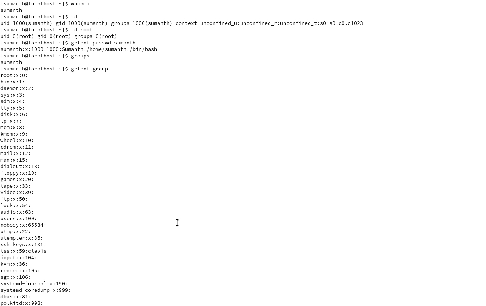
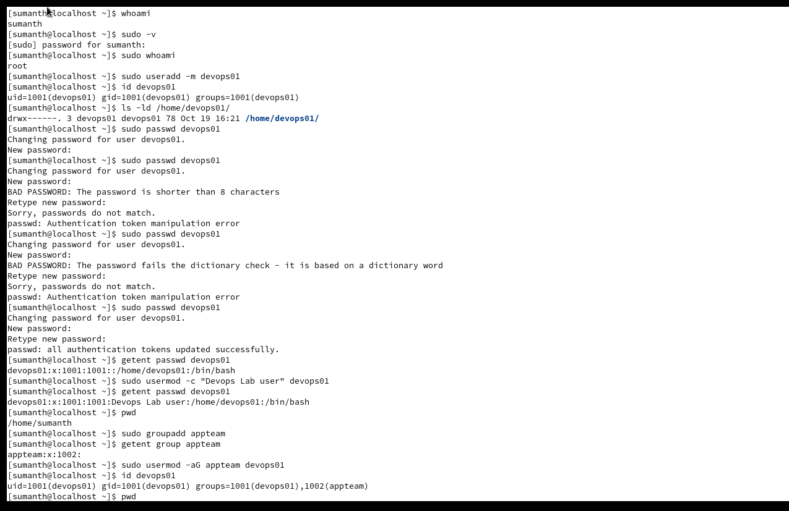
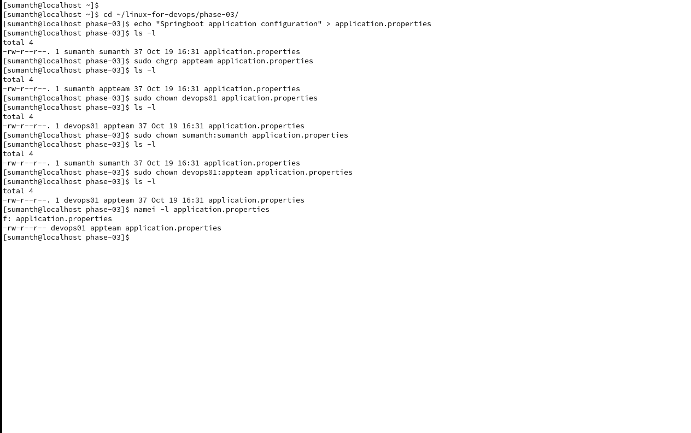
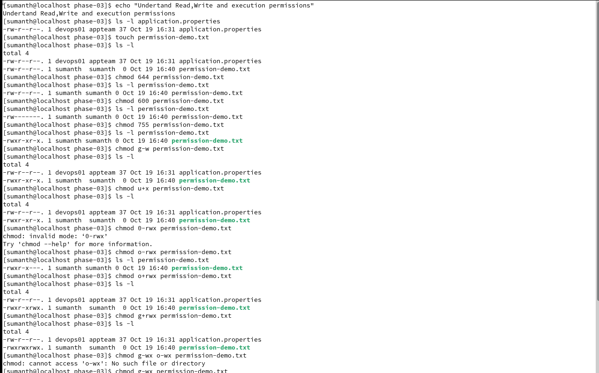
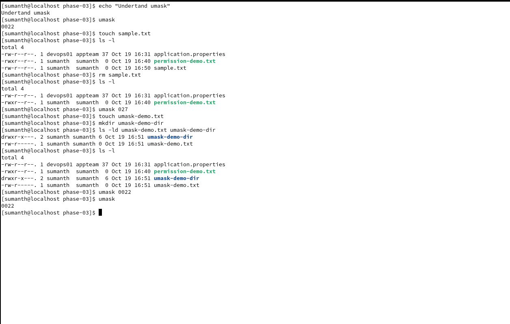
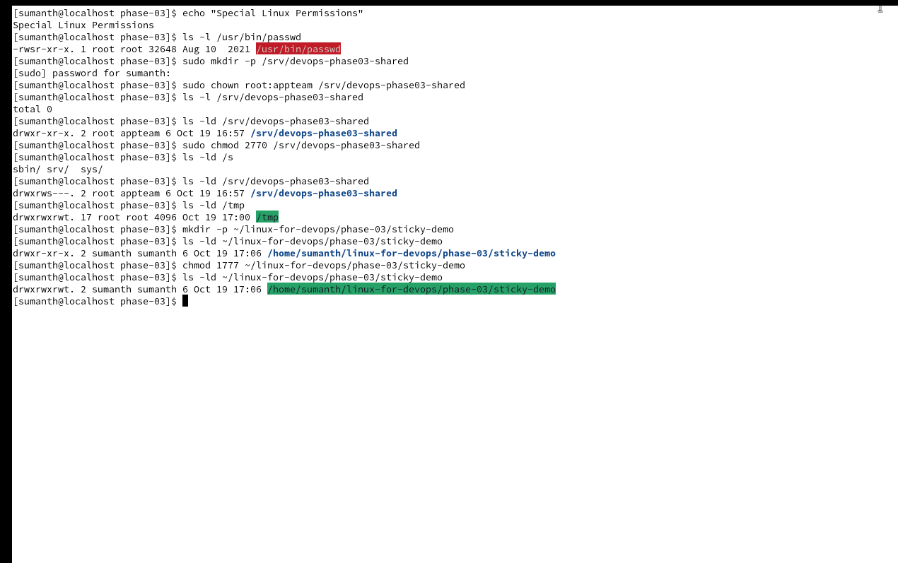
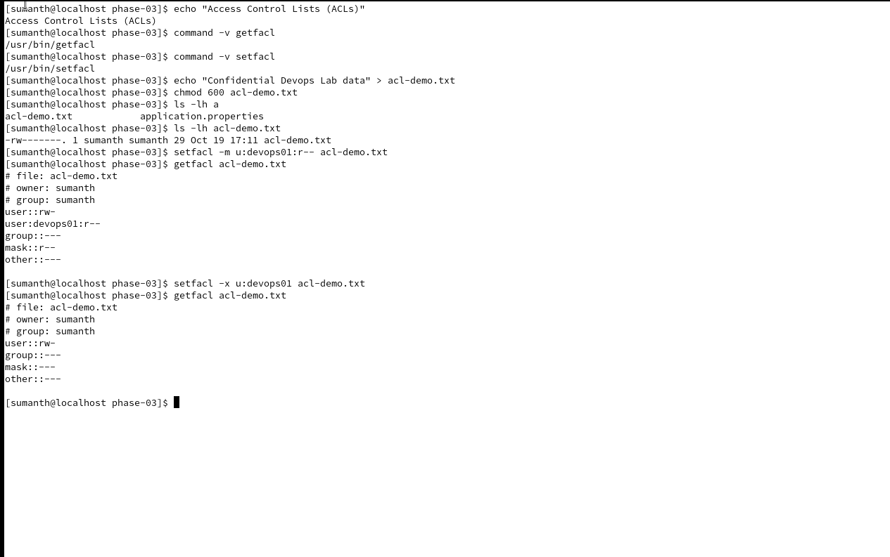
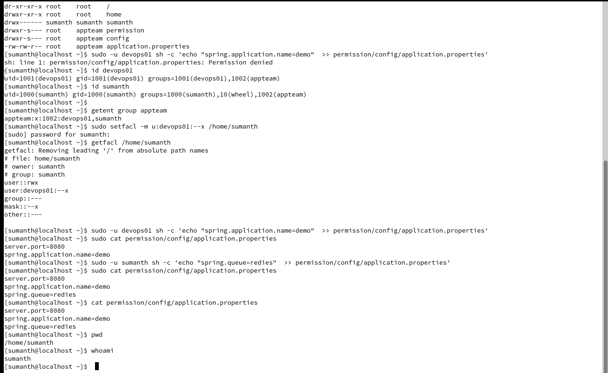
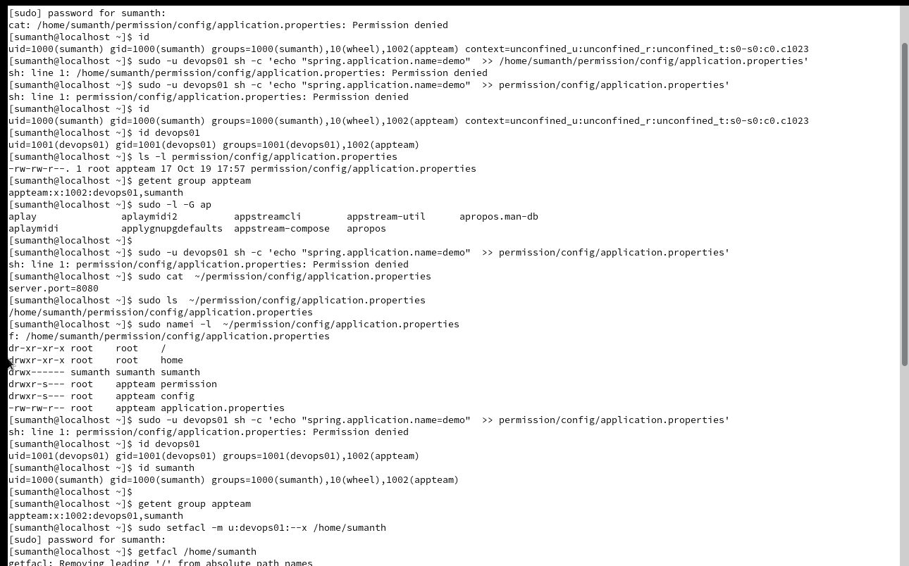

# 🐧 Linux for DevOps — Phase 3: Users, Groups, Permissions & Ownership

Phase 1 & 2 Completed

Phase 03 of 20 · Beginner to Intermediate

Operating System: CentOS Stream 9 Learning approach: Concepts → Commands → Hands-on Labs → Production Troubleshooting → Assignments → Interview Questions

In Phase 2, you learned Linux filesystem navigation, file management, searching, and links.

Now we'll learn who can access files, who can modify them, and how Linux controls permissions.

This is particularly important for DevOps engineers working with Jenkins, Nginx, Docker, Spring Boot applications, and deployment pipelines.

## 1. Phase 3 Learning Roadmap

| Lab | Topic                            | Commands                                    |
| --- | -------------------------------- | ------------------------------------------- |
| 01  | Understanding Linux users        | `whoami`, `id`, `getent`                    |
| 02  | Creating and managing users      | `useradd`, `passwd`, `usermod`, `userdel`   |
| 03  | Linux groups                     | `groupadd`, `groupmod`, `gpasswd`, `groups` |
| 04  | File ownership                   | `ls -l`, `chown`, `chgrp`                   |
| 05  | Linux permissions                | `chmod`, `stat`                             |
| 06  | Numeric and symbolic permissions | `chmod 755`, `u+x`, `g-w`                   |
| 07  | Default permissions and umask    | `umask`                                     |
| 08  | Special permissions              | SUID, SGID, sticky bit                      |
| 09  | Access Control Lists             | `getfacl`, `setfacl`                        |
| 10  | sudo and privilege management    | `sudo`, `visudo`                            |
| 11  | Production troubleshooting       | Permission denied, deployment access        |

We'll perform all labs on your separate CentOS machine.

Before starting

These labs create local users, groups, and files and change permissions. Use your personal Linux practice machine, not a company server. Do not modify system accounts, disable SELinux, or run recursive permission changes against `/`, `/etc`, or `/home`.

# Part 1 — Linux Users and Groups

## 2. What is a Linux user?

Linux is a multi-user operating system. Each user has an identity that the operating system uses to control access to resources.

There are three useful categories to understand:

| User type    | Description                               | Example            |
| ------------ | ----------------------------------------- | ------------------ |
| Root         | Administrative account with UID 0         | `root`             |
| Regular user | Human login account                       | `sumanth`          |
| Service user | Account used to run applications/services | `nginx`, `jenkins` |

A service account may have no interactive login shell.

### Understanding user and group relationships

Access is determined by user identity, group membership, file permissions, ACLs, and other security controls.

### What is UID?

UID stands for User ID.

Linux internally identifies users using numeric IDs.

### What is GID?

GID stands for Group ID.

Groups help multiple users share access to files and directories.

# 3. LAB 01 — Explore Existing Users



## Step 1 — Check your current user

```
whoami
```

Expected:

```
sumanth
```

## Step 2 — Check UID and GID

```
id
```

Example output:

```
uid=1000(sumanth) gid=1000(sumanth) groups=1000(sumanth)
```

Explanation:

| Field        | Meaning               |
| ------------ | --------------------- |
| `uid=1000`   | User ID               |
| `gid=1000`   | Primary group ID      |
| `groups=...` | All group memberships |

## Step 3 — Check root identity

```
id root
```

Expected:

```
uid=0(root) gid=0(root) groups=0(root)
```

## Step 4 — Explore user account records

```
getent passwd sumanth
```

Example:

```
sumanth:x:1000:1000::/home/sumanth:/bin/bash
```

Understand the fields:

```
username : password-placeholder : UID : GID : comment : home : shell
```

`/etc/passwd` stores account metadata, not the actual password hashes. Local password hashes are typically stored in `/etc/shadow`, which has restricted access.

## Step 5 — Check group membership

```
groups
```

And:

```
getent group
```

The second command lists group database entries, which can be lengthy.

### Lab 01 assignment

Answer:

1. What is your UID?
2. What is your primary GID?
3. What is the UID of root?
4. What is the purpose of `/etc/passwd`?
5. What is the difference between a user and a group?

# 4. LAB 02 — Create and Manage Linux Users



Imagine your DevOps team has a new engineer who needs access to a Linux development server.

We'll create a lab user named `devops01`.

## Step 1 — Check sudo access

```
sudo -v
```

If you get an authorization error, stop here and share it with me. The administrative labs require an account authorized to use sudo.

## Step 2 — Create a user

```
sudo useradd -m devops01
```

Explanation:

- `useradd` creates a user account.
- `-m` creates the user's home directory.

Verify:

```
id devops01
```

```
ls -ld /home/devops01
```

## Step 3 — Set a password

```
sudo passwd devops01
```

Linux will ask for a new password and confirmation. Password input will not appear on the screen.

Use a unique lab password and never upload it to GitHub.

## Step 4 — Check account details

```
getent passwd devops01
```

Example:

```
devops01:x:1001:1001::/home/devops01:/bin/bash
```

Your numeric IDs may differ.

## Step 5 — Modify user information

Set a descriptive comment:

```
sudo usermod -c "DevOps Lab User" devops01
```

Verify:

```
getent passwd devops01
```

## Step 6 — Understand user deletion

The command:

```
sudo userdel devops01
```

removes the user account, while `userdel -r` also attempts to remove its home directory and mail spool.

Do not delete `devops01` now. We need it for the remaining labs.

### Production relevance

When engineers join or leave a team, administrators may need to provision or revoke server access.

In real organizations, centralized identity systems and automation often manage this process rather than manually creating accounts on every server.

# 5. LAB 03 — Linux Group Management

## Why do we need groups?

Suppose three engineers work on the same application:

```
devops01
developer01
tester01
```

Instead of assigning access individually, we can create a group called `appteam`.

## Step 1 — Create the group

```
sudo groupadd appteam
```

Verify:

```
getent group appteam
```

## Step 2 — Add the user to the group

```
sudo usermod -aG appteam devops01
```

Explanation:

| Option | Meaning                                 |
| ------ | --------------------------------------- |
| `-a`   | Append to existing supplementary groups |
| `-G`   | Specify supplementary groups            |

Important: Use `-aG` when adding a group without removing the user's existing supplementary group memberships.

## Step 3 — Verify

```
id devops01
```

You should see `appteam` among the groups.

## Step 4 — Remove a user from the group

For learning purposes, understand:

```
sudo gpasswd -d devops01 appteam
```

This removes the user from `appteam`.

Don't execute it yet because the next labs require group membership.

### Interview question

What is the difference between primary and supplementary groups?

A primary group is the default group associated with a user, commonly used when creating files. Supplementary groups provide additional group-based access.

# Part 2 — Linux Ownership and Permissions

# 6. LAB 04 — File Ownership



In Linux, files have an owning user and an owning group.

Create a safe practice directory:

```
mkdir -p ~/linux-for-devops/phase-03
cd ~/linux-for-devops/phase-03
```

Create a file:

```
echo "Spring Boot Application Configuration" > application.properties
```

Inspect it:

```
ls -l application.properties
```

Example:

```
-rw-r--r--. 1 sumanth sumanth 38 Oct 19 11:00 application.properties
```

The first `sumanth` is the file owner; the second is the owning group.

## Step 1 — Change the owning group

```
sudo chgrp appteam application.properties
```

Verify:

```
ls -l application.properties
```

Expected group:

```
appteam
```

## Step 2 — Change owner

```
sudo chown devops01 application.properties
```

Verify:

```
ls -l application.properties
```

## Step 3 — Change owner and group together

```
sudo chown devops01:appteam application.properties
```

### Difference between chown and chgrp

| Command | Purpose                                   |
| ------- | ----------------------------------------- |
| `chown` | Changes file owner; can also change group |
| `chgrp` | Changes file group                        |

### DevOps scenario

A deployment fails with:

```
Permission denied: /opt/myapp/config/application.properties
```

One possible reason is that the application process lacks the required access.

You would investigate:

```
ls -l /opt/myapp/config/application.properties
```

and:

```
namei -l /opt/myapp/config/application.properties
```

The second command shows permissions along the directory path.

Do not immediately run `chmod 777`. First identify the user running the application and the required access.

# 7. LAB 05 — Understand Read, Write and Execute Permissions



This is the most important part of Phase 3.

Run:

```
ls -l application.properties
```

You may see something similar to:

```
-rw-r--r--. 1 devops01 appteam 38 Oct 19 11:00 application.properties
```

Let's break down the permission string.

### Understanding `-rw-r--r--`

## -

File type

Regular file

## rw-

Owner

Read + Write

## r--

Group

Read only

## r--

Others

Read only

On CentOS with SELinux enabled, a trailing `.` can appear in `ls -l` output to indicate a security context.

### Permissions on files

| Permission | Symbol | Meaning                           |
| ---------- | ------ | --------------------------------- |
| Read       | `r`    | Read file contents                |
| Write      | `w`    | Modify file contents              |
| Execute    | `x`    | Execute the file when appropriate |

### Permissions on directories

| Permission | Meaning                                                         |
| ---------- | --------------------------------------------------------------- |
| `r`        | List directory entry names                                      |
| `w`        | Create, delete, or rename entries, subject to other permissions |
| `x`        | Traverse the directory and access entries by name               |

Directory permissions are especially important.

A user may have permission to read a file but still be unable to access it if a parent directory lacks execute permission.

# 8. LAB 06 — Numeric and Symbolic Permissions

## Understanding permission numbers

Each permission has a numeric value:

```
Read    = 4
Write   = 2
Execute = 1
```

For example:

```
rwx = 4 + 2 + 1 = 7
rw- = 4 + 2     = 6
r-x = 4 + 1     = 5
r-- = 4
--- = 0
```

### Common permissions

| Permission | Owner | Group | Others | Typical use                            |
| ---------- | ----- | ----- | ------ | -------------------------------------- |
| `644`      | rw-   | r--   | r--    | Publicly readable configuration        |
| `600`      | rw-   | ---   | ---    | Private user file                      |
| `755`      | rwx   | r-x   | r-x    | Executable scripts, public directories |
| `750`      | rwx   | r-x   | ---    | Restricted executable/directory        |
| `700`      | rwx   | ---   | ---    | Private directory                      |

## Hands-on practice

Create a new file:

```
touch permissions-demo.txt
```

### Step 1 — Set permission 644

```
chmod 644 permissions-demo.txt
```

Check:

```
ls -l permissions-demo.txt
```

Expected permission bits:

```
-rw-r--r--
```

### Step 2 — Set permission 600

```
chmod 600 permissions-demo.txt
```

Expected:

```
-rw-------
```

### Step 3 — Set permission 755

```
chmod 755 permissions-demo.txt
```

Expected:

```
-rwxr-xr-x
```

### Step 4 — Symbolic permissions

Remove group write permission:

```
chmod g-w permissions-demo.txt
```

Add user execute permission:

```
chmod u+x permissions-demo.txt
```

Remove permissions for others:

```
chmod o-rwx permissions-demo.txt
```

Symbols:

- `u` = user/owner
- `g` = group
- `o` = others
- `a` = all
- `+` = add
- `-` = remove
- `=` = assign exact permissions

## Interactive permission calculator

Change the owner, group, and other permissions to see the numeric and symbolic representation.

Permission

Read (4)

Write (2)

Execute (1)

Owner

r

w

x

Group

r

w

x

Others

r

w

x

Numeric permission

# 777

Symbolic permission

## -rwxrwxrwx

Linux command

&#x20;Copy

chmod 777 permissions-demo.txt

644755600700

### Interview question

Why should you avoid `chmod 777` on production files?

Because it grants read, write, and execute permissions to everyone. This can allow unauthorized modification of application files and create serious security risks.

# 9. LAB 07 — Understand umask



## What is umask?

`umask` controls which permission bits are removed from the default permissions when new files and directories are created.

Run:

```
umask
```

You might see:

```
0022
```

For typical new files, the maximum starting permissions are `666`.

For directories, they are `777`.

With a `022` umask:

```
File       666 → 644
Directory  777 → 755
```

The actual calculation removes the bits specified by the mask.

## Hands-on

First check your existing mask:

```
umask
```

Then temporarily set:

```
umask 027
```

Create a file and directory:

```
touch umask-demo.txt
mkdir umask-demo-dir
```

Verify:

```
ls -ld umask-demo.txt umask-demo-dir
```

Typically:

```
File       640
Directory  750
```

Restore the original umask value you recorded before the experiment. If it was `0022`, run:

```
umask 0022
```

# 10. LAB 08 — Special Linux Permissions



Linux has three important special permission mechanisms.

| Permission | Numeric bit | Typical purpose                                           |
| ---------- | ----------- | --------------------------------------------------------- |
| SUID       | `4000`      | Execute a program with the file owner's effective UID     |
| SGID       | `2000`      | Group-related execution or directory inheritance behavior |
| Sticky bit | `1000`      | Restrict deletion/renaming in shared directories          |

## Part A — SUID

Example inspection:

```
ls -l /usr/bin/passwd
```

On many Linux systems, this file has the SUID bit.

You may see:

```
-rwsr-xr-x
```

The `s` in the owner's execute position indicates SUID together with execute permission.

SUID is security-sensitive. We will inspect it, not enable it on arbitrary executables.

## Part B — SGID

Create a shared group directory:

```
sudo mkdir -p /srv/devops-phase03-shared
sudo chown root:appteam /srv/devops-phase03-shared
sudo chmod 2770 /srv/devops-phase03-shared
```

Verify:

```
ls -ld /srv/devops-phase03-shared
```

Expected permission pattern:

```
drwxrws---
```

The `s` in the group execute position indicates SGID.

New files created inside typically inherit the directory's group, subject to filesystem behavior.

## Part C — Sticky bit

Inspect `/tmp`:

```
ls -ld /tmp
```

Typically:

```
drwxrwxrwt
```

The final `t` indicates the sticky bit.

In a shared writable directory, the sticky bit generally prevents users from deleting or renaming entries owned by other users, unless they have the necessary privileged or ownership-based authority.

### Practice safely

Create a directory in your home:

```
mkdir -p ~/linux-for-devops/phase-03/sticky-demo
chmod 1777 ~/linux-for-devops/phase-03/sticky-demo
```

Verify:

```
ls -ld ~/linux-for-devops/phase-03/sticky-demo
```

We'll explore cross-user behavior during the troubleshooting exercises.

# 11. LAB 09 — Access Control Lists (ACLs)



Traditional Linux permissions support three classes:

```
Owner
Group
Others
```

But what if one additional user needs access without changing the owning group?

That's where ACLs are useful.

## Step 1 — Check ACL utilities

```
command -v getfacl
command -v setfacl
```

If they are unavailable, on CentOS Stream 9 you can install the `acl` package:

```
sudo dnf install acl
```

## Step 2 — Create a file

```
echo "Confidential DevOps Lab Data" > acl-demo.txt
chmod 600 acl-demo.txt
```

## Step 3 — Give `devops01` read access

```
setfacl -m u:devops01:r-- acl-demo.txt
```

## Step 4 — Verify

```
getfacl acl-demo.txt
```

You should see an entry similar to:

```
user:devops01:r--
```

Note: Because this file is under `/home/sumanth`, `devops01` may still be unable to read it if the parent directories don't permit traversal. ACLs on a file don't override directory traversal restrictions.

## Step 5 — Remove the ACL entry

```
setfacl -x u:devops01 acl-demo.txt
```

Verify:

```
getfacl acl-demo.txt
```

### Real-world example

A monitoring account needs read-only access to one application log file.

Instead of granting broad permissions, an ACL can give the monitoring account only the access it needs.

# 12. LAB 10 — sudo and Privilege Management

## What is sudo?

`sudo` allows an authorized user to run a command as another user, usually root.

For example:

```
sudo whoami
```

Expected:

```
root
```

Check your sudo permissions:

```
sudo -l
```

## What is sudoers?

Sudo authorization is configured through files such as:

```
/etc/sudoers
/etc/sudoers.d/
```

Never edit `/etc/sudoers` directly with an ordinary text editor. Use `visudo`, which performs syntax validation.

For now, we'll inspect sudo access without changing the configuration.

### Why is sudo important for DevOps?

Consider a Jenkins deployment pipeline.

The pipeline may need to restart an application service:

```
sudo systemctl restart myapp
```

In production, Jenkins should not automatically receive unrestricted root access.

Instead, administrators can configure narrowly scoped permissions for approved commands, with appropriate security controls.

We'll implement more advanced service-related examples in the systemd phase.

# Part 3 — Production Troubleshooting

# 13. LAB 11 — Simulate a Permission Denied Error





This lab demonstrates a common DevOps deployment issue.

## Scenario

A deployment user attempts to update an application configuration file.

The operation fails:

```
Permission denied
```

We need to determine why.

## Step 1 — Create a lab deployment directory

```
sudo mkdir -p /srv/devops-phase03-app/config
```

## Step 2 — Create a configuration file

```
echo "server.port=8080" | sudo tee /srv/devops-phase03-app/config/application.properties > /dev/null
```

## Step 3 — Restrict access

```
sudo chown -R root:root /srv/devops-phase03-app
sudo chmod 755 /srv/devops-phase03-app
sudo chmod 755 /srv/devops-phase03-app/config
sudo chmod 644 /srv/devops-phase03-app/config/application.properties
```

## Step 4 — Reproduce the issue

Run as `devops01`:

```
sudo -u devops01 sh -c 'echo "spring.application.name=demo" >> /srv/devops-phase03-app/config/application.properties'
```

Expected:

```
Permission denied
```

Why?

The file belongs to root and has permission `644`.

Only the owner can write to it.

## Step 5 — Investigate

Check:

```
ls -l /srv/devops-phase03-app/config/application.properties
```

Check the complete directory path:

```
namei -l /srv/devops-phase03-app/config/application.properties
```

Check user identity:

```
id devops01
```

## Step 6 — Fix using a group-based approach

Set the directory and file group to `appteam`:

```
sudo chgrp -R appteam /srv/devops-phase03-app
```

Allow group traversal of directories and group write access to the configuration file:

```
sudo chmod 2750 /srv/devops-phase03-app
sudo chmod 2750 /srv/devops-phase03-app/config
sudo chmod 664 /srv/devops-phase03-app/config/application.properties
```

Here, `2750` sets SGID on the directories so new entries can inherit the `appteam` group.

## Step 7 — Retest

```
sudo -u devops01 sh -c 'echo "spring.application.name=demo" >> /srv/devops-phase03-app/config/application.properties'
```

Now verify:

```
cat /srv/devops-phase03-app/config/application.properties
```

Expected:

```
server.port=8080
spring.application.name=demo
```

If access still fails, inspect the group membership, ACLs, directory traversal permissions, and SELinux context rather than immediately granting broad permissions.

### Root cause analysis

| Area             | Before            | After              |
| ---------------- | ----------------- | ------------------ |
| File owner       | root              | root               |
| File group       | root              | appteam            |
| File permissions | 644               | 664                |
| Deployment user  | devops01          | devops01           |
| Group access     | No write access   | Group write access |
| Result           | Permission denied | Write succeeds     |

This is a simplified lab. In production, application configuration files are often intentionally read-only to runtime users, and a controlled deployment process performs updates.

# 14. Phase 3 Assignments

Complete these on your CentOS system after finishing the labs.

## Assignment 1 — User and Group Administration

Create:

```
Users:
  developer01
  tester01

Group:
  projectteam
```

Tasks:

1. Create both users with home directories.
2. Create the group `projectteam`.
3. Add both users to the group.
4. Verify their UID, GID, and group memberships.
5. Inspect their account records.

## Assignment 2 — File Ownership

Create:

```
/srv/devops-phase03-project/
├── config/
├── logs/
└── scripts/
```

Tasks:

1. Assign the group `projectteam` to the project directory.
2. Give group members access to the directory.
3. Create a sample configuration file.
4. Verify ownership and permissions using `ls -l` and `stat`.

## Assignment 3 — Permission Practice

Create:

```
private.txt
public.txt
deploy.sh
```

Set:

| File          | Permission |
| ------------- | ---------- |
| `private.txt` | 600        |
| `public.txt`  | 644        |
| `deploy.sh`   | 750        |

Explain why each permission is appropriate.

## Assignment 4 — ACL Practice

Create a private file owned by your current user.

Give `developer01` read-only access using ACLs.

Verify the ACL, then remove the ACL entry.

Explain how directory permissions can affect access.

## Assignment 5 — Troubleshooting

Simulate and resolve these issues in your own lab directory:

- User cannot read a file.
- User cannot write to a configuration file.
- User cannot enter a directory.
- Script fails with `Permission denied`.
- Shared directory has incorrect group ownership.

For each issue, document the error, investigation commands, root cause, corrective action, and verification.

# 15. Phase 3 — Interview Questions

| #  | Question                                                               |
| -- | ---------------------------------------------------------------------- |
| 1  | What is the difference between root and a normal Linux user?           |
| 2  | What is UID and GID?                                                   |
| 3  | What is the purpose of `/etc/passwd` and `/etc/shadow`?                |
| 4  | What is the difference between primary and supplementary groups?       |
| 5  | What is the difference between `useradd` and `usermod`?                |
| 6  | Why is `usermod -aG` preferred when adding supplementary groups?       |
| 7  | What is the difference between `chmod`, `chown`, and `chgrp`?          |
| 8  | Explain `chmod 755` and `chmod 644`.                                   |
| 9  | What is the difference between permissions on files and directories?   |
| 10 | What is umask?                                                         |
| 11 | What is SUID?                                                          |
| 12 | What is SGID?                                                          |
| 13 | What is the sticky bit?                                                |
| 14 | What is the difference between traditional permissions and ACLs?       |
| 15 | Why should you avoid `chmod 777` in production?                        |
| 16 | How does `sudo` work?                                                  |
| 17 | How do you investigate a `Permission denied` error?                    |
| 18 | Why might a file be readable but inaccessible through its path?        |
| 19 | How would you troubleshoot Jenkins failing to update deployment files? |
| 20 | What role can SELinux play in file-access failures?                    |
