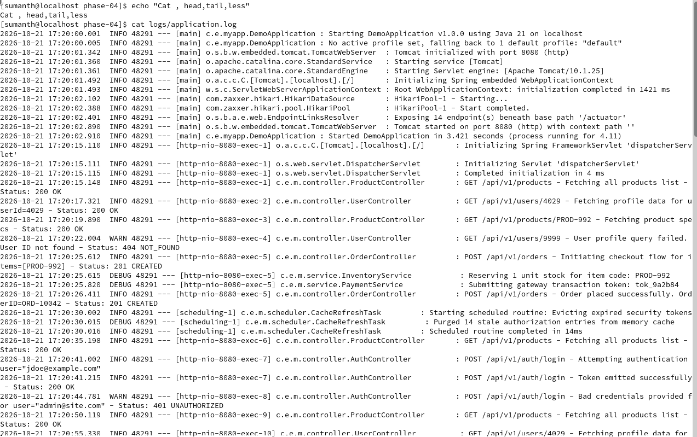
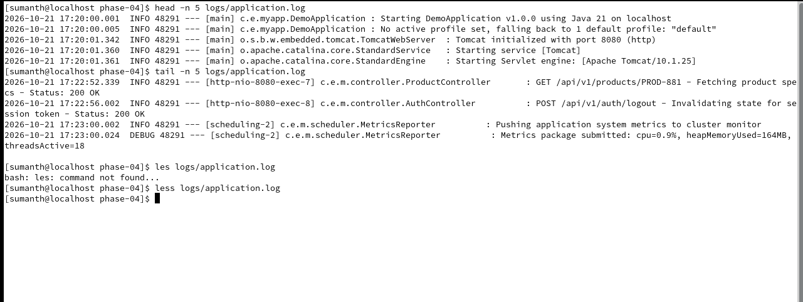
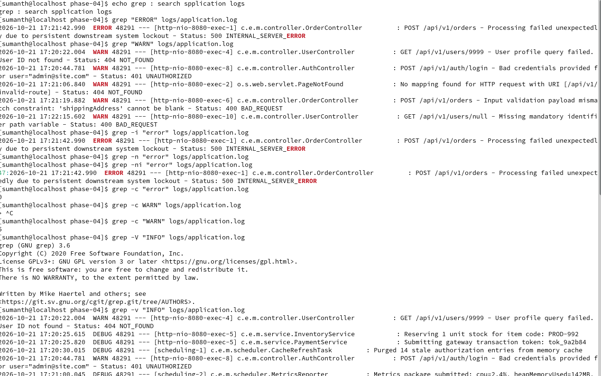
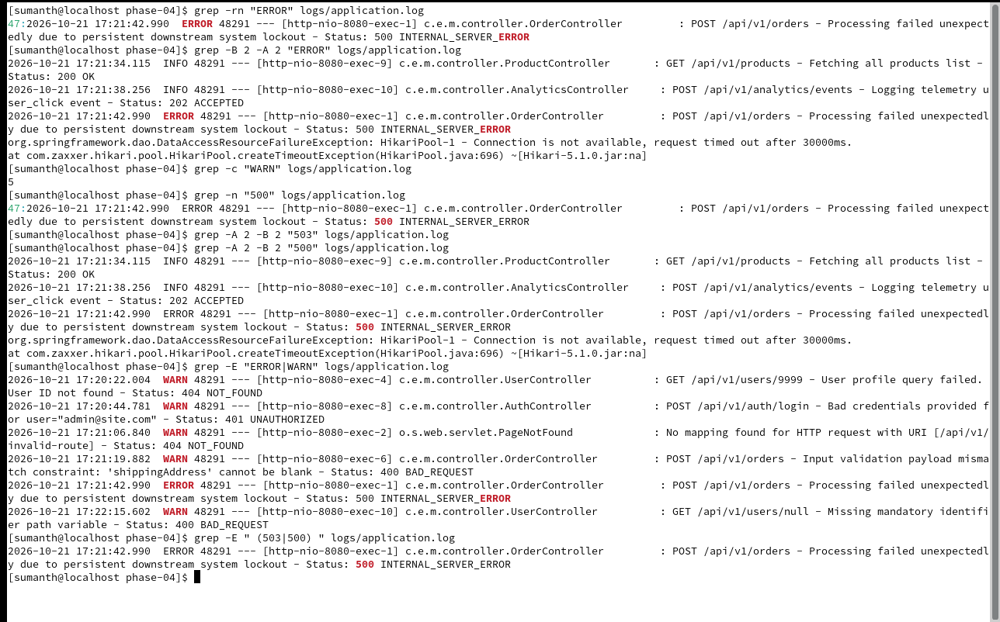
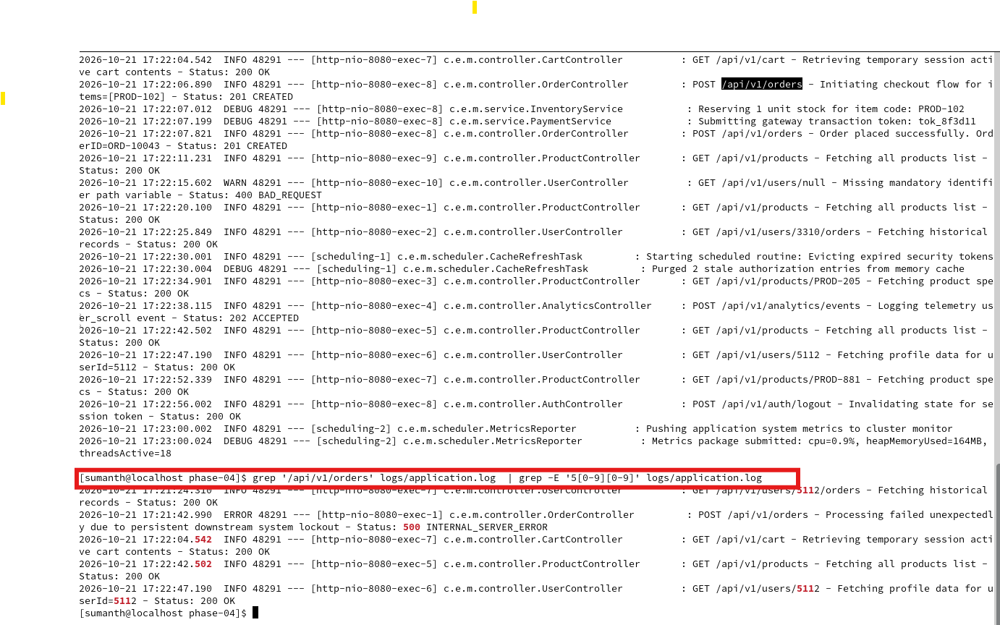
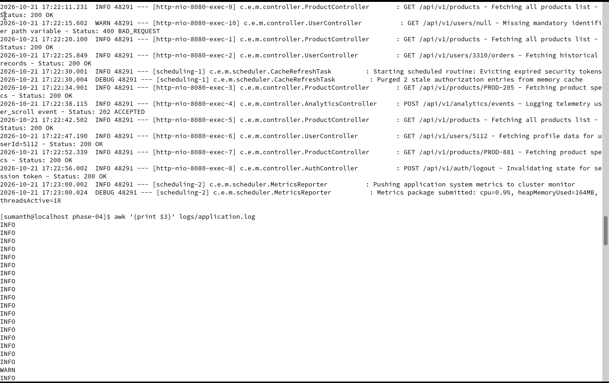
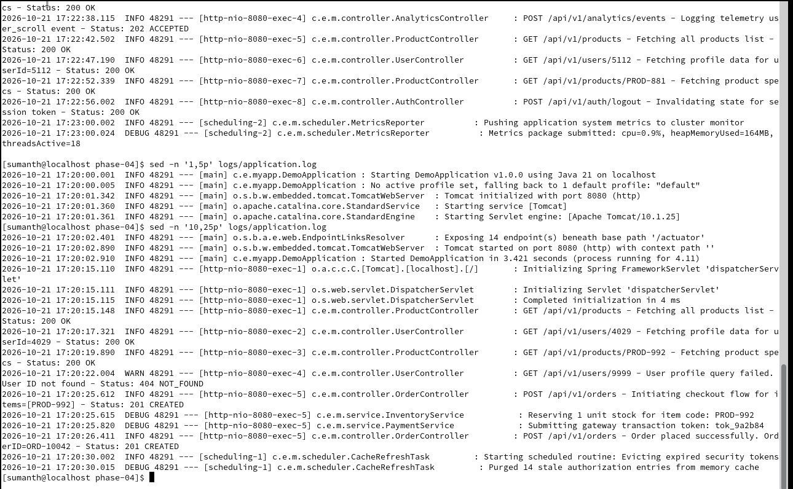
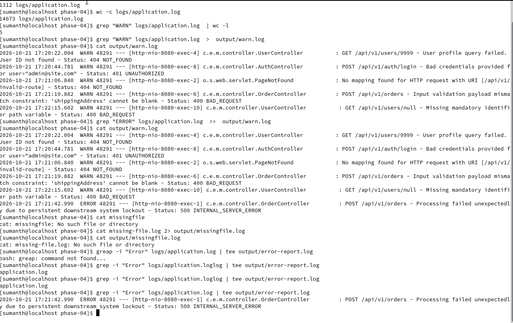
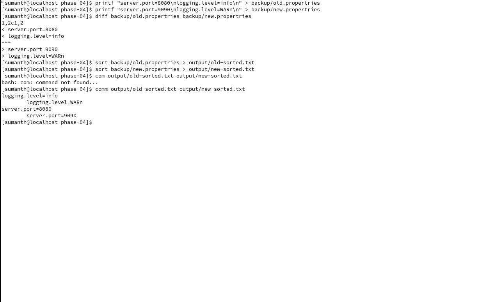

# Linux for DevOps — Phase 4: Text Processing & Production Log Analysis

&#x20;3 Phases Completed

Phase 04 of 20 · Beginner to Intermediate

Operating System: CentOS Stream 9 Lab Environment: Your separate Linux machine Project: Spring Boot Application Log Analysis Learning approach: Concepts → Commands → Examples → Hands-on Labs → Production Troubleshooting → Assignments → GitHub

In Phase 3, you learned users, groups, file permissions, ownership, and access troubleshooting.

In Phase 4, we'll learn how DevOps engineers search, filter, extract, transform, and analyze Linux logs without manually opening large files.

By the end, you'll be able to investigate questions such as:

- Why is my Spring Boot application returning HTTP 500?
- Which API endpoint has the most failures?
- How many ERROR messages occurred?
- Which requests have high response times?
- How do I analyze thousands of log entries from the terminal?

## 1. Phase 4 Learning Roadmap

| Lab | Topic                              | Commands                                |
| --- | ---------------------------------- | --------------------------------------- |
| 01  | Linux text processing fundamentals | `cat`, `head`, `tail`, `less`           |
| 02  | Search text and errors             | `grep`, `grep -i`, `grep -n`, `grep -c` |
| 03  | Advanced pattern matching          | `grep -E`, regular expressions          |
| 04  | Extract fields                     | `cut`, `awk`                            |
| 05  | Process text using awk             | `awk` conditions and calculations       |
| 06  | Replace and filter text            | `sed`                                   |
| 07  | Sort and remove duplicates         | `sort`, `uniq`                          |
| 08  | Count lines, words and bytes       | `wc`                                    |
| 09  | Pipes and redirection              | `\\|`, `>`, `>>`, `2>`, `tee`           |
| 10  | Compare files                      | `diff`, `comm`                          |
| 11  | Real-world log analysis            | Combined commands                       |
| 12  | Production troubleshooting         | HTTP 500, slow APIs, failures           |

We'll use one simulated Spring Boot application throughout the labs.

# Part 1 — Understanding Text Processing

## 2. What is text processing in Linux?

Text processing means reading, searching, filtering, modifying, and analyzing text using commands.

Imagine your application generates:

```
2026-10-21 10:00:01 INFO GET /api/users 200 45ms
2026-10-21 10:00:02 INFO GET /api/products 200 72ms
2026-10-21 10:00:03 ERROR GET /api/orders 500 340ms
2026-10-21 10:00:04 WARN GET /api/users/99 404 55ms
2026-10-21 10:00:05 ERROR POST /api/orders 500 620ms
```

A developer reports:

> The Order Service is returning errors. Please investigate.

Instead of opening the entire log file, you can run:

```
grep "ERROR" application.log
```

To count errors:

```
grep -c "ERROR" application.log
```

To find HTTP 500 responses:

```
awk '$6 == 500' application.log
```

This works because our sample log format places the HTTP status code in field 6.

### How text processing works

# Part 2 — Prepare the Hands-on Environment

## 3. LAB 00 — Create Our Spring Boot Log Analysis Project

All exercises will run under your home directory. No root privileges are required.

### Step 1 — Open the terminal

On your separate CentOS Stream 9 system:

```
whoami
```

Expected:

```
sumanth
```

### Step 2 — Navigate to your home directory

```
cd ~
```

Verify:

```
pwd
```

Expected:

```
/home/sumanth
```

### Step 3 — Create the Phase 4 directory

```
mkdir -p ~/linux-for-devops/phase-04/{logs,output,backup,scripts}
```

Let's understand every part:

| Part                           | Explanation                                   |
| ------------------------------ | --------------------------------------------- |
| `mkdir`                        | Make directory                                |
| `-p`                           | Create missing parent directories             |
| `~`                            | Your home directory                           |
| `{logs,output,backup,scripts}` | Bash brace expansion creates four directories |

### Step 4 — Navigate into the project

```
cd ~/linux-for-devops/phase-04
```

### Step 5 — Verify directory structure

```
ls -lah
```

Expected:

```
phase-04/
├── logs/
├── output/
├── backup/
└── scripts/
```

## 4. Create Sample Spring Boot Application Logs

We'll create a log file containing INFO, WARN, ERROR, HTTP status codes, and response times.

Run the following command exactly:

```
cat > logs/application.log <<'EOF'
2026-10-21 10:00:01 INFO GET /api/users 200 45ms
2026-10-21 10:00:02 INFO GET /api/products 200 72ms
2026-10-21 10:00:03 ERROR GET /api/orders 500 340ms
2026-10-21 10:00:04 WARN GET /api/users/99 404 55ms
2026-10-21 10:00:05 ERROR POST /api/orders 500 620ms
2026-10-21 10:00:06 INFO GET /api/users 200 35ms
2026-10-21 10:00:07 WARN GET /api/products/99 404 60ms
2026-10-21 10:00:08 ERROR GET /api/orders 500 780ms
2026-10-21 10:00:09 INFO POST /api/users 201 120ms
2026-10-21 10:00:10 INFO GET /api/products 200 48ms
2026-10-21 10:00:11 ERROR POST /api/orders 500 910ms
2026-10-21 10:00:12 WARN GET /api/orders/99 404 52ms
2026-10-21 10:00:13 INFO GET /api/users 200 42ms
2026-10-21 10:00:14 ERROR GET /api/payments 503 1100ms
2026-10-21 10:00:15 INFO GET /api/products 200 67ms
2026-10-21 10:00:16 WARN GET /api/users/100 404 49ms
2026-10-21 10:00:17 ERROR POST /api/payments 500 1500ms
2026-10-21 10:00:18 INFO GET /api/users 200 39ms
2026-10-21 10:00:19 ERROR GET /api/orders 500 870ms
2026-10-21 10:00:20 INFO GET /api/products 200 55ms
EOF
```

### What does `<<'EOF'` mean?

This is a here-document.

It allows you to provide multiple lines of text to a command.

The shell reads everything until the closing `EOF`.

Because the delimiter is quoted (`'EOF'`), the shell doesn't expand variables or commands inside the text.

### What does `>` mean?

It redirects standard output to a file, replacing existing contents.

Important: If you run this command again, it will overwrite `logs/application.log`.

### Verify

```
cat logs/application.log
```

Count lines:

```
wc -l logs/application.log
```

Expected:

```
20 logs/application.log
```

# Part 3 — Learn Commands Step by Step

# 5. LAB 01 — cat, head, tail, less

## Command 1 — `cat`

Full form: Concatenate.

Used to display or combine file contents.

```
cat logs/application.log
```

It prints the entire log.

DevOps use case: View a small application configuration or log file.

## Command 2 — `head`

Displays the beginning of a file.

```
head -n 5 logs/application.log
```

Explanation:

- `head` → Displays the beginning.
- `-n` → Number of lines.
- `5` → Display five lines.

Expected: The first five log entries.

## Command 3 — `tail`

Displays the end of a file.

```
tail -n 5 logs/application.log
```

Displays the last five entries.

### Follow live logs

```
tail -f logs/application.log
```

The `-f` option follows appended content.

Open a second terminal and run:

```
echo "2026-10-21 10:00:21 INFO GET /api/health 200 12ms" >> ~/linux-for-devops/phase-04/logs/application.log
```

The new line should appear in the first terminal.

Press `Ctrl+C` to stop.

For the remaining labs, we assume the original 20 entries. If you added this extra entry, you can recreate the sample file using LAB 00.

## Command 4 — `less`

```
less logs/application.log
```

Useful keys:

| Key      | Action           |
| -------- | ---------------- |
| `Space`  | Next page        |
| `b`      | Previous page    |
| `/ERROR` | Search for ERROR |
| `n`      | Next match       |
| `q`      | Quit             |

### Assignment 1

Display the first three lines, last five lines, and search for `ERROR` inside `less`.

# 6. LAB 02 — grep: Search Application Logs

`grep` is one of the most useful Linux commands for DevOps troubleshooting.

## Basic syntax

```
grep "PATTERN" filename
```

### Example 1 — Find ERROR logs

```
grep "ERROR" logs/application.log
```

Expected: Seven matching lines.

### Example 2 — Find WARN logs

```
grep "WARN" logs/application.log
```

Expected: Four matching lines.

### Example 3 — Case-insensitive search

```
grep -i "error" logs/application.log
```

Explanation:

`-i` ignores case differences.

It matches `ERROR`, `error`, and `Error`.

### Example 4 — Show line numbers

```
grep -n "ERROR" logs/application.log
```

`-n` displays line numbers.

### Example 5 — Count matching lines

```
grep -c "ERROR" logs/application.log
```

Expected:

```
7
```

### Example 6 — Invert matching

```
grep -v "INFO" logs/application.log
```

`-v` displays lines that do not match the pattern.

### Example 7 — Search multiple files recursively

```
grep -rn "ERROR" logs/
```

Explanation:

- `-r` → Search recursively.
- `-n` → Show line numbers.

### Example 8 — Show surrounding context

```
grep -B 2 -A 2 "503" logs/application.log
```

- `-B 2` → Two lines before.
- `-A 2` → Two lines after.

DevOps scenario: A Spring Boot application returns HTTP 503. You want to inspect nearby log entries.

### Assignment 2

Find all ERROR entries, count WARN entries, display line numbers for HTTP 500 entries, and display two lines before and after HTTP 503.

# 7. LAB 03 — grep -E and Regular Expressions

Regular expressions help match patterns instead of fixed text.

## Example 1 — Match ERROR or WARN

```
grep -E "ERROR|WARN" logs/application.log
```

`-E` enables extended regular expressions.

The `|` inside the quoted pattern means OR.

### Example 2 — Match HTTP 500 or 503

```
grep -E " (500|503) " logs/application.log
```

### Example 3 — Match lines beginning with a date

```
grep -E "^2026-10-21" logs/application.log
```

`^` means the beginning of a line.

### Example 4 — Match lines ending with milliseconds

```
grep -E "[0-9]+ms$" logs/application.log
```

Explanation:

| Pattern | Meaning                 |
| ------- | ----------------------- |
| `[0-9]` | One digit               |
| `+`     | One or more occurrences |
| `ms`    | Literal text            |
| `$`     | End of line             |

### Assignment 3

Find all 5xx responses and all log entries for `/api/orders`.

# 8. LAB 04 — cut: Extract Fields

`cut` extracts selected fields or character positions from text.

Our log structure is:

```
2026-10-21 10:00:03 ERROR GET /api/orders 500 340ms
```

### Understanding Log Fields

Field 1

Date

Field 2

Time

Field 3

Level

Field 4

Method

Field 5

Endpoint

Field 6

Status

Field 7

Latency

### Extract dates

```
cut -d ' ' -f 1 logs/application.log
```

Explanation:

- `-d ' '` → Use a space as delimiter.
- `-f 1` → Select the first field.

### Extract HTTP methods

```
cut -d ' ' -f 4 logs/application.log
```

### Extract endpoints

```
cut -d ' ' -f 5 logs/application.log
```

### Extract HTTP status codes

```
cut -d ' ' -f 6 logs/application.log
```

Important: `cut` with a single-space delimiter works well for our consistently formatted sample. For logs with variable whitespace, `awk` is generally more convenient.

### Assignment 4

Extract the HTTP methods, API endpoints, and response status codes into separate output files.

# 9. LAB 05 — awk: Powerful Log Processing

`awk` is a text-processing language.

It can filter rows, extract columns, perform calculations, and generate reports.

## Example 1 — Print endpoints

```
awk '{print $5}' logs/application.log
```

`$5` means field 5.

## Example 2 — Print status and endpoint

```
awk '{print $6, $5}' logs/application.log
```

## Example 3 — Find HTTP 500 responses

```
awk '$6 == 500' logs/application.log
```

Explanation:

- `$6` → HTTP status field.
- `==` → Equality comparison.
- `500` → Value to match.

## Example 4 — Find 5xx server errors

```
awk '$6 >= 500 && $6 < 600' logs/application.log
```

`&&` means AND.

## Example 5 — Count HTTP 500 responses

```
awk '$6 == 500 {count++} END {print count+0}' logs/application.log
```

Expected:

```
6
```

### Example 6 — Find slow requests

Our response-time field contains values like `340ms`.

```
awk '{latency=$7+0; if (latency > 500) print $0}' logs/application.log
```

`$7+0` converts the leading numeric portion to a number for comparison.

This finds requests slower than 500 ms.

### Example 7 — Calculate average latency

```
awk '{sum += $7+0; count++} END {if(count) print "Average:", sum/count, "ms"}' logs/application.log
```

For the original 20-line sample, the average is:

```
Average: 343 ms
```

### Example 8 — Count requests by HTTP status

```
awk '{count[$6]++} END {for (status in count) print status, count[status]}' logs/application.log | sort -n
```

Expected:

```
200 7
201 1
404 4
500 6
503 1
```

Correction to observe: These totals add to 19, not 20. Recheck the log manually before accepting any result. The sample actually contains 8 HTTP 200 entries, so the correct output is:

```
200 8
201 1
404 4
500 6
503 1
```

### Assignment 5

Find the number of HTTP 500 responses, all requests slower than 500 ms, average latency, and request counts grouped by HTTP status.

# 10. LAB 06 — sed: Stream Editing

`sed` is a stream editor.

It can search, replace, delete, and select text.

## Example 1 — Replace text in output

```
sed 's/ERROR/CRITICAL/' logs/application.log
```

Explanation:

- `s` → Substitute.
- `ERROR` → Search pattern.
- `CRITICAL` → Replacement.

This prints modified output without changing the original file.

### Example 2 — Replace all occurrences per line

```
sed 's/ERROR/CRITICAL/g' logs/application.log
```

`g` means global replacement on each line.

### Example 3 — Print selected lines

```
sed -n '1,5p' logs/application.log
```

- `-n` → Suppress automatic printing.
- `1,5` → Line range.
- `p` → Print.

### Example 4 — Remove INFO lines from output

```
sed '/INFO/d' logs/application.log
```

`d` means delete from the output stream.

### Example 5 — Save transformed output

```
sed 's/ERROR/CRITICAL/g' logs/application.log > output/critical.log
```

The original log remains unchanged.

Production rule: Avoid editing live application logs in place unless you have a clear operational reason and an approved procedure.

# 11. LAB 07 — sort and uniq

## `sort`

Sorts lines of text.

```
cut -d ' ' -f 6 logs/application.log | sort
```

## `uniq`

Removes adjacent duplicate lines, or counts adjacent groups.

```
cut -d ' ' -f 6 logs/application.log | sort | uniq
```

### Count each HTTP status

```
cut -d ' ' -f 6 logs/application.log | sort | uniq -c
```

Expected counts:

```
8 200
1 201
4 404
6 500
1 503
```

### Sort by frequency

```
cut -d ' ' -f 6 logs/application.log | sort | uniq -c | sort -nr
```

- `-n` → Numeric sort.
- `-r` → Reverse order.

This places the most frequent HTTP status first.

### Production example — Most frequently requested endpoints

```
awk '{print $5}' logs/application.log | sort | uniq -c | sort -nr
```

This helps identify heavily requested endpoints.

# 12. LAB 08 — wc: Count Text

`wc` means word count.

### Count lines

```
wc -l logs/application.log
```

### Count words

```
wc -w logs/application.log
```

### Count bytes

```
wc -c logs/application.log
```

### Count ERROR entries

```
grep "ERROR" logs/application.log | wc -l
```

Expected:

```
7
```

### Count all 5xx responses

```
awk '$6 >= 500 && $6 < 600' logs/application.log | wc -l
```

Expected:

```
7
```

# 13. LAB 09 — Pipes and Redirection

These concepts allow multiple Linux commands to work together.

## Pipe `|`

```
grep "ERROR" logs/application.log | wc -l
```

The output of `grep` becomes the input to `wc`.

## Output redirection `>`

```
grep "ERROR" logs/application.log > output/errors.log
```

Creates or overwrites `output/errors.log`.

## Append redirection `>>`

```
echo "Manual investigation completed" >> output/errors.log
```

Appends a line.

## Error redirection `2>`

```
cat missing-file.log 2> output/command-errors.log
```

Redirects standard error to a file.

## `tee`

```
grep "ERROR" logs/application.log | tee output/error-report.log
```

`tee` displays output on the terminal and writes it to a file.

### Important difference

| Operator | Purpose                        |
| -------- | ------------------------------ |
| `>`      | Overwrite standard output file |
| `>>`     | Append standard output         |
| `2>`     | Redirect standard error        |
| `2>>`    | Append standard error          |
| `\\|`    | Connect commands               |
| `tee`    | Display and save output        |

# 14. LAB 10 — diff and comm

## `diff`

Compares two files and shows differences.

Create two configuration files:

```
printf 'server.port=8080\nlogging.level=INFO\n' > backup/old.properties
printf 'server.port=9090\nlogging.level=DEBUG\n' > backup/new.properties
```

Compare:

```
diff backup/old.properties backup/new.properties
```

### DevOps use case

A deployment changed application behavior. Compare the old and new configuration files to identify differences.

## `comm`

Compares two sorted files line by line.

```
sort backup/old.properties > output/old-sorted.txt
sort backup/new.properties > output/new-sorted.txt
comm output/old-sorted.txt output/new-sorted.txt
```

`comm` displays lines unique to each file and lines common to both.

# Part 4 — Production Troubleshooting Project

# 15. LAB 11 — Investigate Spring Boot HTTP 500 Errors

## Scenario

Your monitoring system reports:

```
Application: Order Service
Environment: Production
Issue: Increased HTTP 500 responses
Impact: Customers cannot place orders
```

The developer asks:

> Can you check which endpoints are failing and whether latency is also increasing?

We'll use our simulated logs.

### Step 1 — Check the total number of requests

```
wc -l logs/application.log
```

Expected: 20.

### Step 2 — Count server errors

```
awk '$6 >= 500 && $6 < 600' logs/application.log | wc -l
```

Expected: 7.

### Step 3 — Calculate server error percentage

```
awk '{total++; if ($6 >= 500 && $6 < 600) errors++} END {if(total) printf "Server Error Rate: %.2f%%\n", errors*100/total}' logs/application.log
```

Expected:

```
Server Error Rate: 35.00%
```

### Step 4 — Find failing endpoints

```
awk '$6 >= 500 && $6 < 600 {print $5}' logs/application.log | sort | uniq -c | sort -nr
```

Expected:

```
5 /api/orders
2 /api/payments
```

### Step 5 — Identify slow requests

```
awk '$7+0 > 500' logs/application.log
```

### Step 6 — Generate an error report

```
awk '$6 >= 500 && $6 < 600' logs/application.log > output/server-errors.log
```

### Step 7 — Verify the report

```
cat output/server-errors.log
```

### Investigation summary

| Metric                 | Result        |
| ---------------------- | ------------- |
| Total requests         | 20            |
| HTTP 200               | 8             |
| HTTP 201               | 1             |
| HTTP 404               | 4             |
| HTTP 500               | 6             |
| HTTP 503               | 1             |
| Total 5xx errors       | 7             |
| Server error rate      | 35%           |
| Most affected endpoint | `/api/orders` |

Conclusion: The sample indicates that Order Service requests have the highest number of server errors. However, logs alone don't prove the root cause. In a real incident, you would investigate application exceptions, database connectivity, downstream services, and recent deployments.

# 16. LAB 12 — Build a Reusable Log Analysis Script

Now we'll combine the commands into a small Bash script.

Create:

```
cat > scripts/analyze-logs.sh <<'EOF'
#!/bin/bash

LOG_FILE="${1:-logs/application.log}"

if [ ! -r "$LOG_FILE" ]; then
    echo "ERROR: Cannot read log file: $LOG_FILE" >&2
    exit 1
fi

echo "===== APPLICATION LOG REPORT ====="

echo "Total Requests:"
wc -l < "$LOG_FILE"

echo "ERROR Entries:"
grep -c "ERROR" "$LOG_FILE" || true

echo "HTTP 5xx Errors:"
awk '$6 >= 500 && $6 < 600 {count++} END {print count+0}' "$LOG_FILE"

echo "HTTP Status Distribution:"
awk '{count[$6]++} END {for (s in count) print s, count[s]}' "$LOG_FILE" | sort -n

echo "Slow Requests (>500ms):"
awk '$7+0 > 500' "$LOG_FILE"

echo "Average Latency:"
awk '{sum += $7+0; count++} END {if(count) printf "%.2f ms\n", sum/count; else print "N/A"}' "$LOG_FILE"

echo "===== END REPORT ====="
EOF
```

Make the script executable:

```
chmod 755 scripts/analyze-logs.sh
```

Execute:

```
./scripts/analyze-logs.sh
```

Save the report:

```
./scripts/analyze-logs.sh | tee output/final-report.txt
```

This introduces basic Bash scripting, which we'll explore much more deeply in Phase 15.

# 17. Phase 4 Assignments

Complete these independently on your CentOS machine.

## Assignment 1 — Basic Log Inspection

- Display the first five lines.
- Display the last five lines.
- Count total log entries.
- Follow the log file in real time.

## Assignment 2 — grep Practice

- Find all ERROR entries.
- Find all WARN entries.
- Search case-insensitively.
- Show line numbers for HTTP 500 entries.
- Find ERROR or WARN using one command.

## Assignment 3 — cut and awk

- Extract all API endpoints.
- Extract all HTTP status codes.
- Count HTTP 500 responses.
- Calculate average latency.
- Find requests slower than 500 ms.

## Assignment 4 — sed

- Replace ERROR with CRITICAL in output.
- Print lines 5–10.
- Remove INFO entries from output.
- Save a transformed copy of the log.

## Assignment 5 — Sorting and Counting

- Count each HTTP status code.
- Identify the most requested endpoint.
- Identify the endpoint with the most 5xx errors.
- Sort response times numerically.

## Assignment 6 — Production Incident Report

Write a short incident report containing:

```
Incident: Increased HTTP 500 Responses

Application:
Order Service

Total Requests:
20

Server Errors:
7

Error Rate:
35%

Most Affected Endpoint:
/api/orders

Commands Used:
<Your commands>

Findings:
<Your analysis>

Possible Causes:
<Your hypotheses>

Next Investigation Steps:
<Your recommendations>
```

# 18. Phase 4 Interview Questions

| #  | Question                                                          |
| -- | ----------------------------------------------------------------- |
| 1  | What is text processing in Linux?                                 |
| 2  | What is the difference between `cat`, `head`, `tail`, and `less`? |
| 3  | What does `tail -f` do?                                           |
| 4  | What is `grep`?                                                   |
| 5  | What is the difference between `grep` and `grep -E`?              |
| 6  | What do `grep -i`, `-n`, `-v`, and `-c` mean?                     |
| 7  | What is a regular expression?                                     |
| 8  | What is the difference between `cut` and `awk`?                   |
| 9  | What do `$1`, `$2`, and `$NF` mean in awk?                        |
| 10 | How do you filter HTTP 500 errors using awk?                      |
| 11 | How do you calculate average response time?                       |
| 12 | What is sed?                                                      |
| 13 | What is the difference between `sed` and `sed -i`?                |
| 14 | Why do we use `sort` before `uniq`?                               |
| 15 | What does `uniq -c` do?                                           |
| 16 | What is the difference between `wc -l`, `wc -w`, and `wc -c`?     |
| 17 | What is a Linux pipe?                                             |
| 18 | What is the difference between `>`, `>>`, and `2>`?               |
| 19 | What does `tee` do?                                               |
| 20 | How would you troubleshoot an application returning HTTP 500?     |


```

Suggested commit message:

```
Phase 04: Linux text processing and Spring Boot log analysis
```

# 20. Phase 4 Completion Checklist

Your lab progress

0 / 16

Create Phase 4 lab directories and sample logs

LAB 01 — cat, head, tail, less

LAB 02 — grep searching

LAB 03 — Extended regular expressions

LAB 04 — cut field extraction

LAB 05 — awk filtering and calculations

LAB 06 — sed text processing

LAB 07 — sort and uniq

LAB 08 — wc counting

LAB 09 — Pipes and redirection

LAB 10 — diff and comm

LAB 11 — HTTP 500 investigation

LAB 12 — Bash log analysis script

Complete six assignments

Answer interview questions

Update GitHub repository

&#x20;Copy progress checklist

## What you should do now

Start with LAB 00 through LAB 03 on your separate CentOS Stream 9 machine.

After completing them, share the output of:

```
pwd
wc -l logs/application.log
grep -c "ERROR" logs/application.log
grep -E " (500|503) " logs/application.log
```

I'll review your results and explain any mistakes before we continue with `cut`, `awk`, and `sed`.

Once you complete Phase 4, we'll prepare your GitHub `README.md`, `commands.md`, `assignment.md`, and `lab.md`, including the screenshots and your production-style incident report.
## Screenshot Gallery

These screenshots show the Phase 4 text-processing exercises. Click an image to view it at full size on GitHub.

### Viewing files and searching logs

| Exercise | Screenshot |
| --- | --- |
| Display the application log with `cat` |  |
| Preview log files with `head`, `tail`, and `less` |  |
| Search log levels with `grep` |  |
| Find HTTP errors with surrounding context |  |

### Extracting and processing text

| Exercise | Screenshot |
| --- | --- |
| Filter API requests with a command pipeline |  |
| Extract log fields with `awk` |  |
| Select log ranges with `sed` |  |
| Count and export matching log entries |  |
| Compare and sort configuration files |  |
