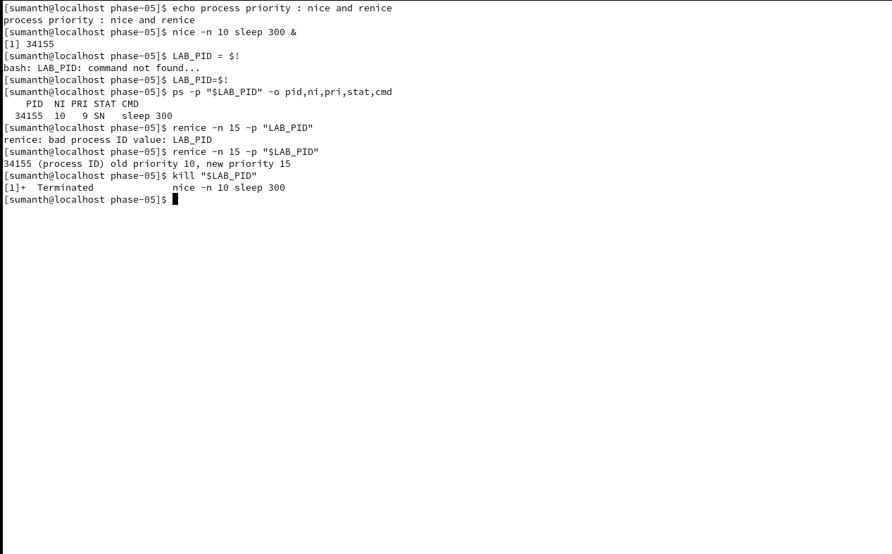
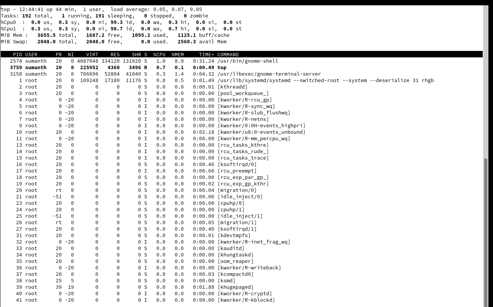
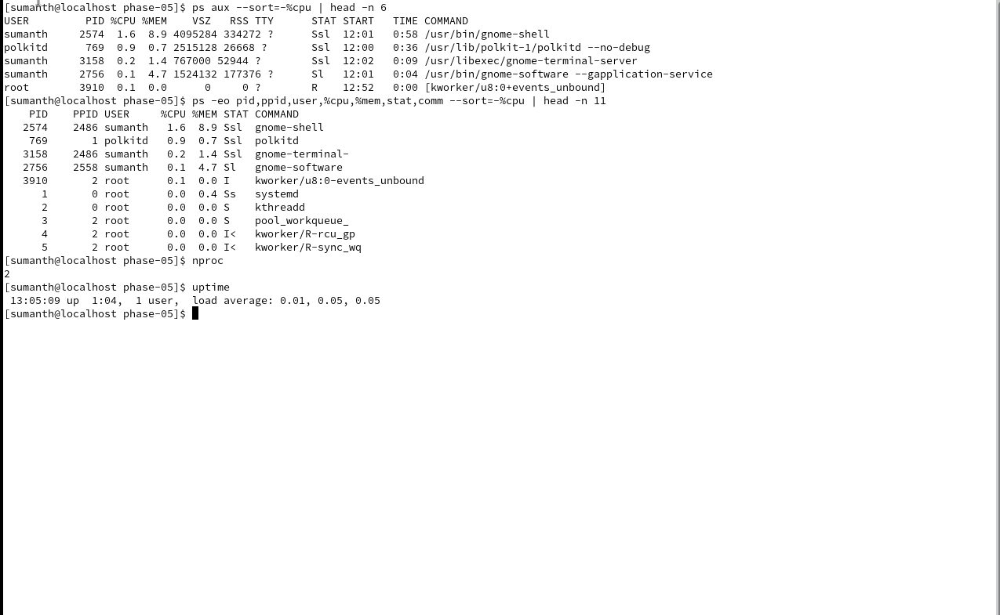
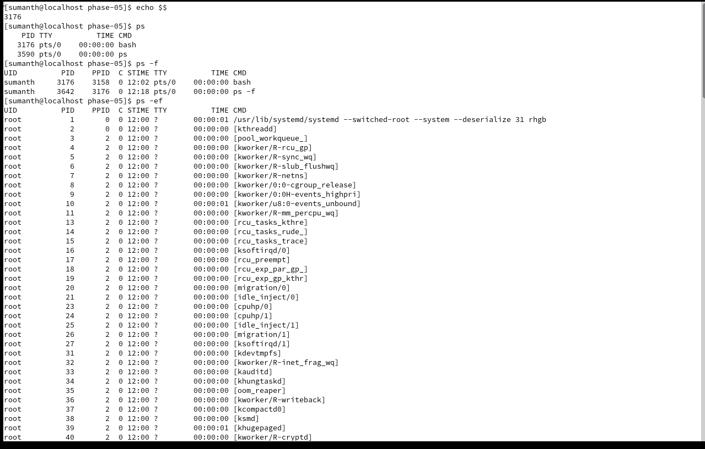
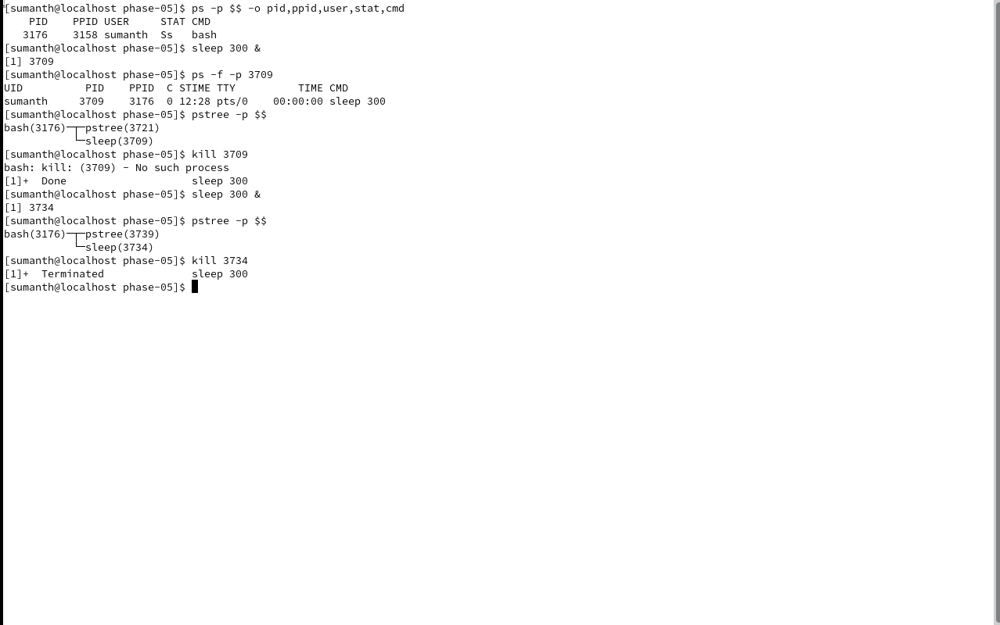
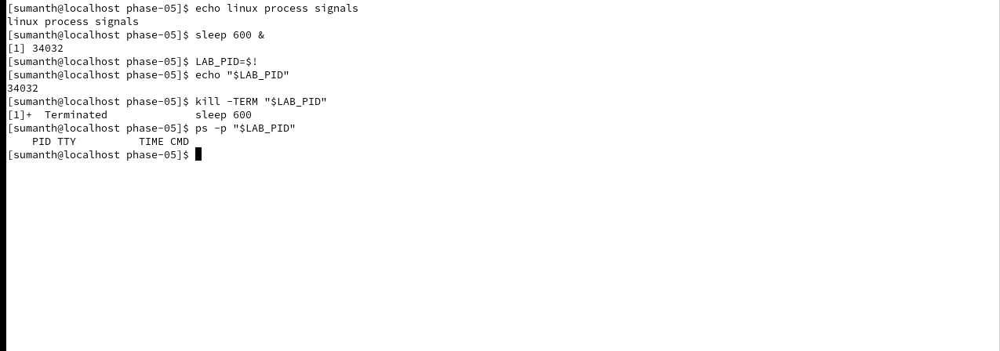
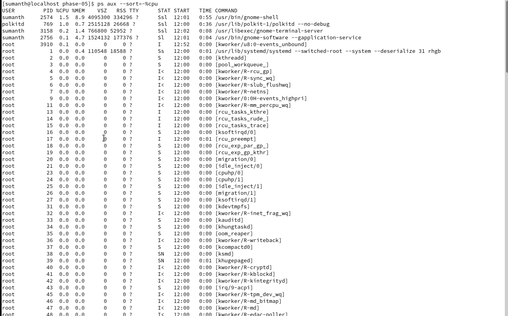
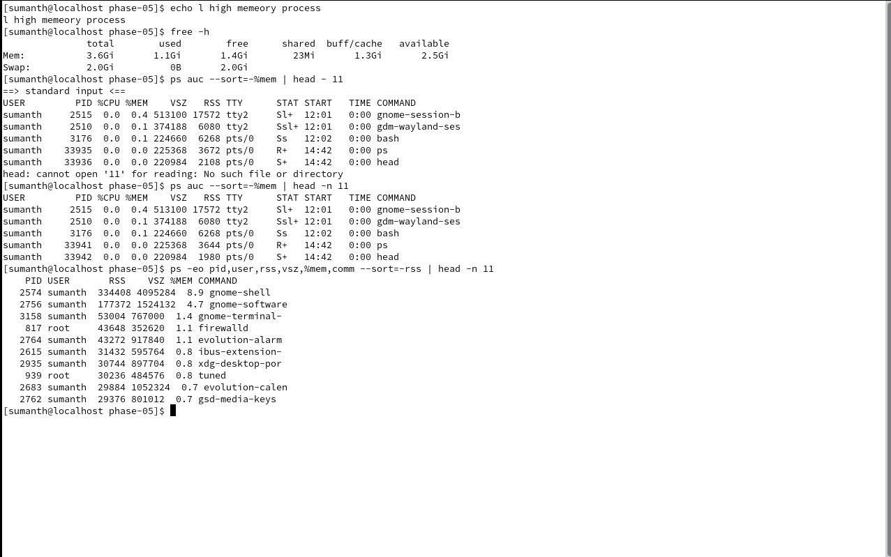

# Linux for DevOps — Phase 05: Linux Process Management & Production Troubleshooting

&#x20;Phases 01–04 Covered

Phase 05 of 20 · Beginner to Advanced

Operating System: CentOS Stream 9 Lab Environment: Your separate Linux machine running in Oracle VirtualBox Project: Linux Process Monitoring & Troubleshooting Approach: Concepts → Commands → Examples → Hands-on Labs → Production Scenarios → Assignments → GitHub

In Phase 4, you learned Linux text processing and log analysis using `grep`, `awk`, `sed`, `cut`, `sort`, and `uniq`.

Now we'll focus on one of the most important skills for a DevOps engineer: understanding how applications run as Linux processes and how to troubleshoot them when something goes wrong.

## 1. What you'll learn

| Lab | Topic                                  | Commands                              |
| --- | -------------------------------------- | ------------------------------------- |
| 01  | Linux processes and PIDs               | `ps`, `echo $$`, `pidof`              |
| 02  | Parent and child processes             | `pstree`, `ps -ef`                    |
| 03  | Real-time process monitoring           | `top`, `htop`                         |
| 04  | CPU-consuming processes                | `ps aux --sort=-%cpu`                 |
| 05  | Memory-consuming processes             | `ps aux --sort=-%mem`, `free`         |
| 06  | Find processes                         | `pgrep`, `pidof`, `ps`                |
| 07  | Process signals                        | `kill`, `pkill`, `SIGTERM`, `SIGKILL` |
| 08  | Foreground/background jobs             | `jobs`, `bg`, `fg`, `&`               |
| 09  | Process priorities                     | `nice`, `renice`                      |
| 10  | Long-running processes                 | `nohup`, `disown`                     |
| 11  | Process states                         | R, S, D, T, Z                         |
| 12  | Zombie and orphan processes            | `ps`, `pstree`                        |
| 13  | CPU and memory troubleshooting         | `top`, `vmstat`, `free`               |
| 14  | Production application troubleshooting | Combined commands                     |

We'll use a simulated application process to practice without modifying system services.

# Part 1 — Linux Process Fundamentals

## 2. What is a process in Linux?

A process is a running instance of a program.

For example, consider a Java application:

```
java -jar application.jar
```

When you execute this command, Linux creates a process to run the Java application.

A process has attributes such as:

- PID — Process ID
- PPID — Parent Process ID
- UID — User ID
- CPU usage
- Memory usage
- Process state
- Priority
- Open files and network connections

### Program vs process

| Program                                         | Process                             |
| ----------------------------------------------- | ----------------------------------- |
| File containing executable code                 | Running instance of a program       |
| Stored on disk                                  | Has runtime state managed by the OS |
| Example: `/usr/bin/java`                        | Example: Java process with PID 2456 |
| One program can have multiple running instances | Each instance has its own PID       |

## 3. How Linux processes work

Illustrative process relationships. Actual parent-child relationships depend on how each service or shell was started.

### Important terms

| Term | Full form                           | Meaning                                                  |
| ---- | ----------------------------------- | -------------------------------------------------------- |
| PID  | Process ID                          | Unique identifier for a process within its PID namespace |
| PPID | Parent Process ID                   | PID of the parent process                                |
| UID  | User ID                             | Identity associated with the process                     |
| CPU  | Central Processing Unit             | Executes instructions                                    |
| RSS  | Resident Set Size                   | Process memory currently resident in RAM                 |
| VSZ  | Virtual Memory Size                 | Virtual address-space size                               |
| TTY  | Teletype terminal (historical term) | Associated terminal                                      |
| STAT | Process status                      | Current process state                                    |

# Part 2 — Hands-on Labs

## LAB 00 — Prepare Your Lab Environment

On your separate CentOS Stream 9 machine:

```
cd ~
mkdir -p linux-for-devops/phase-05/{scripts,logs,output}
cd linux-for-devops/phase-05
pwd
```

Expected:

```
/home/sumanth/linux-for-devops/phase-05
```

We'll run all practice commands from this directory.

Lab safety

Use only the test processes you create. Do not kill `systemd`, SSH, database, Jenkins, or other system processes. Because your VirtualBox machine has limited RAM, we'll avoid memory stress tests and heavy CPU load.

## LAB 01 — Understanding PID and PPID

### Command 1: `echo $$`

```
echo $$
```

`$$` expands to the current shell's PID in Bash.

Example:

```
2540
```

### Command 2: `ps`

Full form: Process Status.

```
ps
```

Example:

```
PID    TTY       TIME CMD
2540   pts/0 00:00:00 bash
2601   pts/0 00:00:00 ps
```

Explanation:

| Column | Meaning           |
| ------ | ----------------- |
| PID    | Process ID        |
| TTY    | Terminal          |
| TIME   | CPU time consumed |
| CMD    | Command           |

### Command 3: `ps -f`

```
ps -f
```

Displays additional details, including PPID.

### Command 4: `ps -ef`

```
ps -ef
```

Explanation:

- `-e` — Select all processes.
- `-f` — Full-format listing.

### Command 5: Inspect your shell

```
ps -p $$ -o pid,ppid,user,stat,cmd
```

Here:

- `-p $$` selects your shell's PID.
- `-o` specifies the columns to display.

### Assignment

Identify your shell's PID, PPID, username, and process state.

## LAB 02 — Parent and Child Processes

### What is a parent process?

A parent process creates another process, called a child process.

For example, your Bash shell can launch `sleep`.

### Step 1 — Start a child process

```
sleep 300 &
```

The `&` runs the command in the background.

You might see:

```
[1] 2650
```

`[1]` is the shell job number, and `2650` is the PID.

### Step 2 — Inspect it

```
ps -f -p 2650
```

Replace `2650` with your actual PID.

### Step 3 — Find the process tree

```
pstree -p $$
```

If `pstree` is unavailable:

```
sudo dnf install psmisc
```

### Step 4 — Stop the lab process

```
kill 2650
```

Replace with the PID of your test `sleep` process.

### DevOps relevance

Understanding parent-child relationships helps troubleshoot shell scripts, Jenkins jobs, process supervision, and orphaned child processes.

## LAB 03 — Real-Time Process Monitoring

### Command: `top`

```
top
```

`top` displays live process and system statistics.

### Example top output — CPU summary

# 92.5%

Idle

# 5.0%

User CPU

# 2.5%

System CPU

Illustrative values, not measurements from your machine.

### Important `top` columns

| Column  | Meaning                    |
| ------- | -------------------------- |
| PID     | Process ID                 |
| USER    | Process owner              |
| PR      | Scheduling priority        |
| NI      | Nice value                 |
| VIRT    | Virtual memory             |
| RES     | Resident memory            |
| SHR     | Shared memory              |
| S       | Process state              |
| %CPU    | CPU usage                  |
| %MEM    | Percentage of physical RAM |
| TIME+   | Total CPU time             |
| COMMAND | Process name or command    |

### Useful keyboard shortcuts

| Key | Action                     |
| --- | -------------------------- |
| `P` | Sort by CPU                |
| `M` | Sort by memory             |
| `k` | Prompt to signal a process |
| `1` | Toggle per-CPU statistics  |
| `c` | Toggle full command line   |
| `q` | Quit                       |

For now, don't use `k` inside `top`.

### Command: `htop`

`htop` is an optional interactive process monitor.

Install if needed:

```
sudo dnf install htop
```

Package availability depends on enabled repositories. `top` is sufficient for this phase.

### Assignment

Open `top`, identify the highest CPU-consuming process, identify the highest memory-consuming process, and exit safely.

## LAB 04 — Find High CPU Processes

### Command 1

```
ps aux
```

`aux` uses BSD-style options:

- `a` — Include processes associated with terminals from other users.
- `u` — User-oriented output.
- `x` — Include processes without controlling terminals.

### Command 2 — Sort by CPU

```
ps aux --sort=-%cpu
```

The minus sign indicates descending order.

### Command 3 — Top five processes

```
ps aux --sort=-%cpu | head -n 6
```

Why six lines?

The first line is the header, followed by five process rows.

### Command 4 — Custom output

```
ps -eo pid,ppid,user,%cpu,%mem,stat,comm --sort=-%cpu | head -n 11
```

This displays the header and ten process rows.

### Production scenario

An alert says:

```
CRITICAL: CPU utilization above 90%
```

You investigate with:

```
uptime
nproc
top
ps aux --sort=-%cpu | head
```

Important: High load average is not always caused by high CPU usage. Processes waiting for I/O can also contribute.

## LAB 05 — Find High Memory Processes

### Command 1 — Check system memory

```
free -h
```

### Command 2 — Sort processes by memory

```
ps aux --sort=-%mem | head -n 11
```

### Command 3 — Show memory fields

```
ps -eo pid,user,rss,vsz,%mem,comm --sort=-rss | head -n 11
```

### Understanding RSS and VSZ

| Metric | Meaning                                |
| ------ | -------------------------------------- |
| RSS    | Resident memory currently in RAM       |
| VSZ    | Virtual memory size                    |
| %MEM   | RSS as a percentage of physical memory |

RSS includes some shared memory, so summing RSS values across processes can double-count shared pages.

### DevOps scenario

A Java service gradually consumes more memory.

Initial investigation:

```
free -h
ps aux --sort=-%mem | head
```

Later, we'll use Java-specific tools such as `jcmd` to investigate heap and thread behavior.

## LAB 06 — Find Processes Using pgrep and pidof

### `pgrep`

Searches running processes using names or other criteria.

```
pgrep bash
```

Display PID and process name:

```
pgrep -a bash
```

Search processes owned by your user:

```
pgrep -u "$USER" -a
```

### `pidof`

Finds PIDs of running programs by executable name.

```
pidof bash
```

`pgrep` supports richer selection options, while `pidof` is primarily intended to find PIDs by program name.

### Safe practice

```
sleep 600 &
LAB_PID=$!
echo "$LAB_PID"
ps -p "$LAB_PID" -o pid,ppid,stat,cmd
```

`$!` expands to the PID of the most recent asynchronous command launched by the current shell.

Stop it:

```
kill "$LAB_PID"
wait "$LAB_PID"
```

`wait` may return a nonzero status because the process was terminated by a signal; that is expected.

## LAB 07 — Linux Process Signals

### What is a signal?

A signal is a notification sent to a process to request or report an event.

Important signals:

| Signal  | Number on Linux    | Meaning                                |
| ------- | ------------------ | -------------------------------------- |
| SIGHUP  | 1                  | Hangup; some services use it to reload |
| SIGINT  | 2                  | Interrupt, commonly Ctrl+C             |
| SIGQUIT | 3                  | Quit                                   |
| SIGKILL | 9                  | Force termination                      |
| SIGTERM | 15                 | Request graceful termination           |
| SIGSTOP | 19 on x86-64 Linux | Stop process                           |
| SIGCONT | 18 on x86-64 Linux | Continue stopped process               |

Signal numbers can vary across architectures, so signal names are clearer.

### Step 1 — Create a process

```
sleep 600 &
LAB_PID=$!
```

### Step 2 — Send SIGTERM

```
kill -TERM "$LAB_PID"
```

`SIGTERM` requests termination and can be handled by the process.

### Step 3 — Verify

```
ps -p "$LAB_PID"
```

If the process has exited, it will no longer appear as a running process.

### SIGKILL

```
kill -KILL PID
```

`SIGKILL` cannot be caught, blocked, or ignored by a normal user-space process.

Do not use SIGKILL on real application processes without understanding the consequences. It prevents normal application shutdown handling.

### `pkill`

```
pkill -TERM -f "some-unique-test-process"
```

`pkill` matches processes by criteria. Be careful with `-f`, because it matches command lines and may affect more processes than intended.

For our labs, prefer killing the specific PID stored in `$LAB_PID`.

## LAB 08 — Foreground and Background Processes

### Foreground process

```
sleep 300
```

The terminal waits until the command finishes or is interrupted.

Press `Ctrl+C` to stop it.

### Background process

```
sleep 300 &
```

Your shell returns immediately.

### `jobs`

```
jobs -l
```

Displays jobs managed by your current shell.

### `fg`

```
fg %1
```

Brings job 1 into the foreground, if job 1 exists.

### `Ctrl+Z`

Suspends the current foreground job, when supported.

### `bg`

```
bg %1
```

Resumes a stopped job in the background.

### Practice sequence

Run these commands in the same terminal:

```
sleep 300
```

Press `Ctrl+Z`, then:

```
jobs -l
bg %1
jobs -l
fg %1
```

Press `Ctrl+C` to terminate the test.

### Interview question

What is the difference between `&`, `bg`, and `fg`?

`&` starts a command in the background. `bg` resumes a stopped shell job in the background. `fg` moves a shell job to the foreground.

## LAB 09 — Process Priority: nice and renice

Linux scheduling priority affects how CPU time is allocated among runnable processes.

### What is a nice value?

For normal Linux processes, nice values generally range from:

```
-20 → Higher scheduling priority
  0 → Default
 19 → Lower scheduling priority
```

A lower nice value means the process is treated more favorably by the normal scheduler, but it does not guarantee CPU time.

### Step 1 — Start a low-priority process

```
nice -n 10 sleep 300 &
LAB_PID=$!
```

### Step 2 — Inspect it

```
ps -p "$LAB_PID" -o pid,ni,pri,stat,cmd
```

### Step 3 — Change priority

```
renice -n 15 -p "$LAB_PID"
```

Increasing the nice value lowers scheduling priority and is normally permitted for your own process.

### Step 4 — Stop it

```
kill "$LAB_PID"
```

### Production relevance

Priority adjustment can help manage competing CPU workloads, but it is not a replacement for proper resource sizing, cgroups, or workload isolation.

## LAB 10 — Run Long-Lived Processes Using nohup

### What is nohup?

`nohup` means no hangup.

It runs a command with SIGHUP ignored, allowing many programs to continue after the terminal session ends.

### Example

```
nohup sleep 600 > logs/nohup-test.log 2>&1 &
LAB_PID=$!
```

Explanation:

| Component   | Purpose                               |
| ----------- | ------------------------------------- |
| `nohup`     | Ignore SIGHUP                         |
| `sleep 600` | Test process                          |
| `>`         | Redirect stdout                       |
| `2>&1`      | Redirect stderr to stdout destination |
| `&`         | Run in background                     |

Check:

```
ps -p "$LAB_PID" -o pid,stat,cmd
```

Stop:

```
kill "$LAB_PID"
```

### `disown`

Bash's `disown` removes a job from the shell's job table or marks it not to receive shell-generated SIGHUP, depending on options.

Example:

```
sleep 600 &
disown
```

The process may continue running, but `disown` is not a general-purpose service manager.

Production recommendation: Use systemd for long-running application services rather than relying on `nohup` or `disown`.

# Part 3 — Advanced Process Concepts

## LAB 11 — Linux Process States

Linux processes have different states.

| State | Name                  | Meaning                                          |
| ----- | --------------------- | ------------------------------------------------ |
| R     | Running/Runnable      | Running or waiting for CPU                       |
| S     | Interruptible sleep   | Waiting for an event                             |
| D     | Uninterruptible sleep | Usually waiting in kernel operations such as I/O |
| T     | Stopped               | Stopped by signal or tracing                     |
| Z     | Zombie                | Exited but not yet reaped by parent              |
| I     | Idle                  | Idle kernel thread on supported kernels          |

### Check process states

```
ps -eo pid,ppid,stat,comm | head -n 25
```

### Count processes by primary state

```
ps -eo stat= | cut -c1 | sort | uniq -c
```

### Additional STAT characters

You may also see:

- `<` — High-priority process
- `N` — Low-priority process
- `s` — Session leader
- `l` — Multithreaded
- `+` — Foreground process group

### DevOps scenario

A process remains in state `D`.

You should investigate storage, network filesystems, or other kernel waits rather than assuming the application is simply consuming CPU.

## LAB 12 — Zombie and Orphan Processes

### What is a zombie process?

A zombie process has exited, but its parent has not yet collected its exit status.

It usually consumes little memory and no CPU execution time, but still occupies a process-table entry.

### What is an orphan process?

An orphan process is a running process whose original parent has exited. It is reparented to an appropriate reaper process, often PID 1 or a designated subreaper.

### Inspect zombie processes

```
ps -eo pid,ppid,stat,comm | awk '$3 ~ /^Z/'
```

If no results appear, that's normal.

### Troubleshooting principle

You cannot eliminate a zombie by sending SIGKILL to the zombie itself because it has already exited.

Investigate its parent process and why the parent isn't collecting child exit statuses.

We won't intentionally create zombies in this beginner lab.

# Part 4 — Production Troubleshooting Labs

## LAB 13 — High CPU Troubleshooting

### Scenario

Monitoring reports:

```
Server: prod-app-01
CPU Usage: 95%
Application: Spring Boot
Impact: High API latency
```

### Step 1 — Confirm the server

```
hostname
```

### Step 2 — Check system load

```
uptime
```

### Step 3 — Check CPU availability

```
nproc
```

### Step 4 — Inspect CPU utilization

```
top
```

### Step 5 — Find high CPU processes

```
ps aux --sort=-%cpu | head -n 11
```

### Step 6 — Inspect a suspicious PID

```
ps -p PID -o pid,ppid,user,%cpu,%mem,etime,stat,cmd
```

Replace `PID` with the actual process ID.

### Step 7 — Inspect process threads

```
ps -L -p PID -o pid,tid,pcpu,stat,comm
```

### Step 8 — Inspect system activity

```
vmstat 1 5
```

`vmstat` provides information about processes, memory, paging, block I/O, interrupts, and CPU activity.

Important fields:

| Field | Meaning                                |
| ----- | -------------------------------------- |
| r     | Runnable tasks                         |
| b     | Tasks blocked in uninterruptible sleep |
| si    | Swap in                                |
| so    | Swap out                               |
| us    | User CPU                               |
| sy    | System CPU                             |
| id    | Idle CPU                               |
| wa    | I/O wait                               |
| st    | Steal time                             |

### Possible causes

- Application infinite loop
- High request traffic
- Excessive garbage collection
- CPU-heavy batch jobs
- Insufficient CPU resources
- Expensive application processing

Do not assume a root cause until the evidence supports it.

## LAB 14 — High Memory Troubleshooting

### Scenario

```
Server: prod-app-01
Memory Usage: 95%
Application: Java Spring Boot
Impact: Slow response and possible OOM
```

### Step 1 — Check memory

```
free -h
```

### Step 2 — Find memory-heavy processes

```
ps aux --sort=-%mem | head -n 11
```

### Step 3 — Inspect a process

```
ps -p PID -o pid,user,rss,vsz,%mem,etime,cmd
```

### Step 4 — Check swap

```
swapon --show
```

### Step 5 — Check OOM messages

```
sudo journalctl -k --no-pager | grep -i -E 'out of memory|oom|killed process'
```

### Possible causes

- Memory leak
- Java heap configuration
- Too many concurrent requests
- Excessive caching
- Multiple resource-intensive applications
- Insufficient system memory

### Important distinction

A process using a lot of memory does not automatically mean it has a memory leak. You need to examine usage trends, workload, application behavior, and memory reclamation.

# Part 5 — Real-World DevOps Project

## LAB 15 — Simulate an Application Process and Troubleshoot It

We'll create a simple application-like Bash script that runs continuously and writes logs.

### Step 1 — Create the script

Run this from `~/linux-for-devops/phase-05`:

```
cat > scripts/demo-app.sh <<'EOF'
#!/bin/bash

while true
do
    echo "$(date '+%Y-%m-%d %H:%M:%S') INFO Demo application heartbeat"
    sleep 5
done
EOF
```

### Step 2 — Make it executable

```
chmod 755 scripts/demo-app.sh
```

### Step 3 — Start the application

```
./scripts/demo-app.sh > logs/demo-app.log 2>&1 &
APP_PID=$!
echo "$APP_PID" > output/demo-app.pid
```

### Step 4 — Verify the process

```
ps -p "$APP_PID" -o pid,ppid,user,stat,%cpu,%mem,etime,cmd
```

### Step 5 — Check logs

```
tail -n 5 logs/demo-app.log
```

### Step 6 — Monitor the process

```
top -p "$APP_PID"
```

Press `q` to exit.

### Step 7 — Stop the application gracefully

```
kill -TERM "$APP_PID"
```

### Step 8 — Verify shutdown

```
ps -p "$APP_PID"
```

### Step 9 — Confirm no new log entries

```
tail -n 5 logs/demo-app.log
```

### What you learned

You've practiced the same fundamental steps used to investigate application processes:

Start → Identify PID → Inspect → Monitor → Read Logs → Send Signal → Verify Shutdown

In later phases, we'll run a real application under systemd and learn how to restart it, inspect failures, and configure automatic recovery.

# Part 6 — Phase 5 Assignments

Complete these independently on your CentOS machine.

## Assignment 1 — Process Identification

Create a background process and identify:

1. PID
2. PPID
3. Username
4. Process state
5. Elapsed time
6. Command

## Assignment 2 — CPU and Memory

Identify the five highest CPU-consuming processes and five highest memory-consuming processes.

Record the commands and explain `%CPU`, `%MEM`, RSS, and VSZ.

## Assignment 3 — Background Jobs

Start a `sleep` process in the foreground, suspend it, move it to the background, return it to the foreground, and terminate it.

Explain the difference between `Ctrl+C` and `Ctrl+Z`.

## Assignment 4 — Process Signals

Create two separate test processes.

Terminate one using SIGTERM and the other using SIGKILL.

Explain why SIGTERM is generally preferred for graceful shutdown.

## Assignment 5 — Process Priority

Start a process with nice value 10, change it to 15, and verify the change.

Explain the relationship between nice value and scheduling priority.

## Assignment 6 — Application Troubleshooting

Run `demo-app.sh`, capture its PID, inspect CPU and memory usage, view its logs, and stop it safely.

Document the complete troubleshooting flow.

## Assignment 7 — Production Scenario

A Spring Boot service has stopped responding, but the Linux server is reachable.

Explain how you would determine:

- Whether the application process exists
- Whether it is consuming CPU or memory
- Whether it has stopped or become a zombie
- Whether logs indicate errors
- Whether a restart is appropriate

For now, use the commands learned in this phase. We'll cover ports, systemd, and network diagnostics more deeply in later phases.

# Part 7 — Interview Questions

| #  | Question                                                                      |
| -- | ----------------------------------------------------------------------------- |
| 1  | What is a Linux process?                                                      |
| 2  | What is the difference between a program and a process?                       |
| 3  | What is PID and PPID?                                                         |
| 4  | What is the difference between `ps` and `top`?                                |
| 5  | What does `ps aux` show?                                                      |
| 6  | How do you find the top five CPU-consuming processes?                         |
| 7  | How do you find memory-consuming processes?                                   |
| 8  | What is the difference between `pgrep` and `pidof`?                           |
| 9  | What is the difference between `kill` and `pkill`?                            |
| 10 | What is the difference between SIGTERM and SIGKILL?                           |
| 11 | What happens when you press Ctrl+C?                                           |
| 12 | What happens when you press Ctrl+Z?                                           |
| 13 | What is the difference between foreground and background jobs?                |
| 14 | What is the purpose of `nohup`?                                               |
| 15 | What is the difference between `nohup` and `disown`?                          |
| 16 | What is a nice value?                                                         |
| 17 | What is the difference between `nice` and `renice`?                           |
| 18 | What are the Linux process states?                                            |
| 19 | What is a zombie process?                                                     |
| 20 | What is an orphan process?                                                    |
| 21 | Why can't you kill a zombie process directly?                                 |
| 22 | What does `vmstat` show?                                                      |
| 23 | What is the difference between RSS and VSZ?                                   |
| 24 | How do you investigate high CPU usage?                                        |
| 25 | How do you investigate high memory usage?                                     |
| 26 | How do you identify an OOM-killed process?                                    |
| 27 | How do you inspect threads of a Java process?                                 |
| 28 | What would you do if a Java application stopped responding?                   |
| 29 | Why should you avoid using SIGKILL as the first response?                     |
| 30 | How would you troubleshoot a Jenkins job that leaves child processes running? |


# Phase 7 Screenshots

### Process priority with nice and renice



### Live process monitoring with top



### Sorting processes and checking system load



### Listing processes with ps



### Inspecting process trees and background jobs



### Sending a termination signal to a process



### Inspecting CPU usage by process



### Managing foreground and background jobs


### Inspecting memory usage by process


